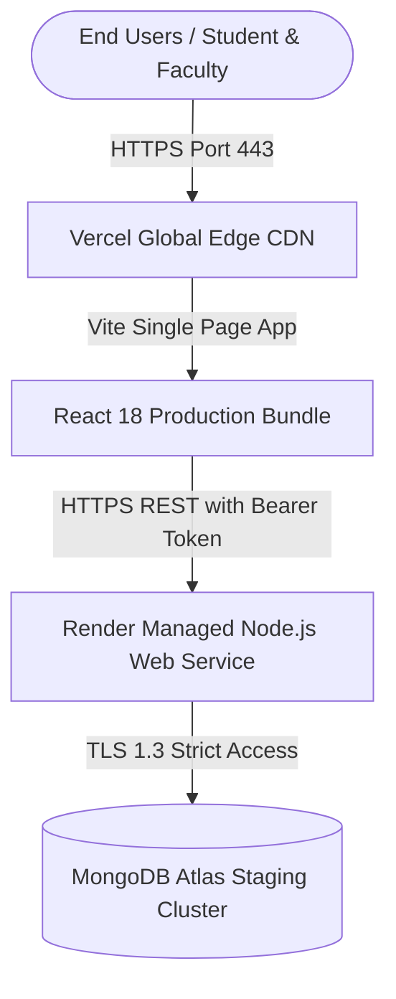

# CampusOne — Controlled Staging Deployment & Operations Guide

**Application:** CampusOne (AI-Powered Student Academic, Skills & Career Development Platform)  
**Stack:** MERN (React 18 + Vite, Node.js + Express, MongoDB Atlas)  
**Deployment Target:** Managed Cloud Architecture (Vercel Frontend + Render Backend + MongoDB Atlas Database)  

---

## 1. Managed Deployment Architecture & Topology

To minimize operational complexity, eliminate manual VM maintenance, and avoid error-prone manual reverse proxy/certbot renewals, CampusOne uses managed hosting services:



### Topology Specification
| Component | Hosting Provider | Staging URL / Hostname | Management Rationale |
| :--- | :--- | :--- | :--- |
| **Frontend SPA** | **Vercel** (or Render Static) | `https://staging-campusone.vercel.app` | Global edge caching, automatic HTTPS/SSL, zero-config SPA client routing (`/index.html`), instant Git preview deploys. Cost: Free tier. |
| **Backend REST API** | **Render Web Service** | `https://api-staging-campusone.onrender.com` | Managed Node.js runtime, automatic TLS certificates, built-in health-check probe monitoring, auto-restart on crashes, native environment secret vault. Cost: Free / $7/mo Starter. |
| **Database** | **MongoDB Atlas** | `mongodb+srv://...` | Managed 3-node replica set, automated point-in-time recovery, continuous daily snapshots, IP allowlisting, least-privilege database user. Cost: Free M0 tier. |

---

## 2. Phase 3: MongoDB Atlas Staging Setup Guide

Follow these exact steps in the [MongoDB Atlas Console](https://cloud.mongodb.com):

### Step 1: Create a Dedicated Staging Database
1. Under your Atlas Organization, create a Project named `CampusOne-Staging`.
2. Deploy a Cluster (Select **M0 Free** or **M10 Dedicated**).
3. Select an AWS/GCP region closest to your backend hosting region (e.g. `us-east-1` or `ap-south-1`).
4. Ensure the database name is explicitly `campusone_staging` (never share the production database).

### Step 2: Create a Least-Privilege Database User
1. Navigate to **Security** → **Database Access** → **Add New Database User**.
2. **Authentication Method:** Password.
3. **Database User Privileges:** Select **Built-in Role** → **Only read and write to specific databases**.
4. In the database privileges table, add:
   - **Database:** `campusone_staging`
   - **Role:** `readWrite`
5. Do not grant `atlasAdmin`, `dbAdminAnyDatabase`, or access to other databases.

### Step 3: Configure Network Access
1. Navigate to **Security** → **Network Access** → **Add IP Address**.
2. If Render's static outbound IP is known, enter Render's outbound IP range.
3. For Render dynamic outbound IP on free/starter tiers, select **Allow Access from Anywhere** (`0.0.0.0/0`) temporarily, secured strictly by the strong database username and password.

### Step 4: Retrieve and Format the Connection String
1. Navigate to **Deployment** → **Database** → Click **Connect** on your cluster.
2. Select **Drivers** (Node.js version 5.5 or later).
3. Copy the SRV connection URI and append the database name:
   ```text
   mongodb+srv://<username>:<password>@campusone-staging.xxxx.mongodb.net/campusone_staging?retryWrites=true&w=majority
   ```

### Step 5: Backup & Disaster Recovery Procedures
- **Automated Snapshots:** In Atlas, navigate to **Backup** → ensure continuous cloud backups are enabled (7-day point-in-time restore).
- **On-Demand Staging Backup Test:**
  ```bash
  # Test backup using mongodump (replace with your staging URI)
  mongodump --uri="mongodb+srv://<username>:<password>@campusone-staging.xxxx.mongodb.net/campusone_staging" --out=./backup-staging
  ```
- **On-Demand Staging Restoration Test:**
  ```bash
  # Test restoring a snapshot into a separate verification database
  mongorestore --uri="mongodb+srv://<username>:<password>@campusone-staging.xxxx.mongodb.net/campusone_staging_restore_test" ./backup-staging/campusone_staging
  ```

---

## 3. Phase 4: Backend Configuration (Render)

### Step 1: Create the Web Service
1. Sign in to [Render](https://render.com) and click **New +** → **Web Service**.
2. Connect your Git repository (`CampusOne`).
3. Set the configuration:
   - **Name:** `api-staging-campusone`
   - **Root Directory:** `server`
   - **Environment:** `Node`
   - **Build Command:** `npm install`
   - **Start Command:** `npm start`
   - **Health Check Path:** `/api/v1/health`

### Step 2: Generate High-Entropy Cryptographic Secrets
Run this in your terminal to generate 256-bit cryptographic secrets:
```bash
# Generate JWT_SECRET
node -e "console.log(require('crypto').randomBytes(32).toString('hex'))"

# Generate ADMIN_REGISTRATION_SECRET
node -e "console.log(require('crypto').randomBytes(32).toString('hex'))"
```

### Step 3: Configure Environment Variables in Render Dashboard
Add these environment variables securely in Render **Environment** tab:

| Variable Name | Value / Format | Purpose |
| :--- | :--- | :--- |
| `NODE_ENV` | `staging` | Configures staging behavior and JSON logging |
| `PORT` | `10000` | Port assigned by Render runtime |
| `MONGO_URI` | `mongodb+srv://.../campusone_staging?...` | MongoDB Atlas staging connection string |
| `JWT_SECRET` | `<generated_random_64_char_hex_secret>` | HMAC-SHA256 token signing key |
| `JWT_EXPIRES_IN` | `7d` | Token session expiration |
| `ADMIN_REGISTRATION_SECRET`| `<generated_admin_passphrase>` | Secret required to register admin/teacher accounts |
| `CLIENT_URL` | `https://staging-campusone.vercel.app` | CORS allowlist (exact staging frontend URL) |
| `TRUST_PROXY` | `1` | Enables Render reverse proxy IP extraction for rate limiting |
| `RATE_LIMIT_WINDOW_MS` | `900000` | 15 minutes window |
| `RATE_LIMIT_AUTH_MAX` | `50` | Max auth attempts per IP per window |
| `RATE_LIMIT_AI_MAX` | `60` | Max AI queries per IP per window |

---

## 4. Phase 5: Frontend Configuration (Vercel)

### Step 1: Import Project to Vercel
1. Sign in to [Vercel](https://vercel.com) and click **Add New...** → **Project**.
2. Import the Git repository (`CampusOne`).
3. Set configuration:
   - **Framework Preset:** `Vite`
   - **Root Directory:** `client`
   - **Build Command:** `npm run build`
   - **Output Directory:** `dist`

### Step 2: Set Staging Environment Variable
Under **Environment Variables**, add:
- **Key:** `VITE_API_BASE_URL`
- **Value:** `https://api-staging-campusone.onrender.com/api/v1`
- **Target Environments:** Preview, Production (Staging branch)

### Step 3: SPA Routing Rewrite Rule
Ensure `client/vercel.json` exists to route all SPA paths to `index.html`:
```json
{
  "rewrites": [
    {
      "source": "/(.*)",
      "destination": "/index.html"
    }
  ]
}
```

---

## 5. Phase 6: Staging Deployment Smoke Test Suite

To verify the live staging deployment, execute the 15 automated smoke tests directly against your deployed staging API:

```bash
# Execute against your live staging backend:
STAGING_API_URL="https://api-staging-campusone.onrender.com/api/v1" npm run test:smoke --prefix server
```

### The 15 Automated Smoke Tests Executed:
1. **SMOKE-01:** Backend service liveness endpoint responds (`GET /api/v1/health` → HTTP 200).
2. **SMOKE-02:** Backend health returns service name, version, and `X-Request-Id` correlation header.
3. **SMOKE-03:** Database readiness probe reports connectivity (`GET /api/v1/health/ready` → HTTP 200).
4. **SMOKE-04:** Student registration registers account and returns signed JWT (`POST /api/v1/auth/register`).
5. **SMOKE-05:** Student login verifies credentials and issues valid token (`POST /api/v1/auth/login`).
6. **SMOKE-06:** Session recovery endpoint hydrates student profile (`GET /api/v1/auth/me`).
7. **SMOKE-07:** Student profile endpoint retrieves live attendance metrics and timetable (`GET /api/v1/academics/student-profile`).
8. **SMOKE-08:** Teacher marks session attendance for course (`POST /api/v1/academics/attendance/mark`).
9. **SMOKE-09:** Student profile recomputes dynamic attendance rate after marking.
10. **SMOKE-10:** Teacher creates new diagnostic assessment (`POST /api/v1/tests/create`).
11. **SMOKE-11:** Student submits answers and server computes authoritative grade (`POST /api/v1/tests/submit`).
12. **SMOKE-12:** Assessment attempt result retrieves saved grade and review (`GET /api/v1/tests/results/:attemptId`).
13. **SMOKE-13:** Cross-student result access is blocked with HTTP 403 (Owner data isolation).
14. **SMOKE-14:** Administrator lists registered institution users (`GET /api/v1/admin/users`).
15. **SMOKE-15:** Session logout endpoint terminates active session (`POST /api/v1/auth/logout`).

---

## 6. Developer Next Steps for Live Staging Launch

Because managed cloud provisioning requires developer account credentials, the developer must perform the following actions to complete live cloud deployment:

1. **MongoDB Atlas:** Follow Section 2 to create the `campusone_staging` cluster and retrieve the connection string.
2. **Render Backend:** Follow Section 3 to create the web service and inject the environment variables.
3. **Vercel Frontend:** Follow Section 4 to import the `client` directory and set `VITE_API_BASE_URL`.
4. **Run Smoke Test Verification:** Execute `STAGING_API_URL="https://api-staging-campusone.onrender.com/api/v1" npm run test:smoke --prefix server`.
5. **Update Team:** Once the 15 smoke tests pass against the live URLs, approve staging for user acceptance testing.
