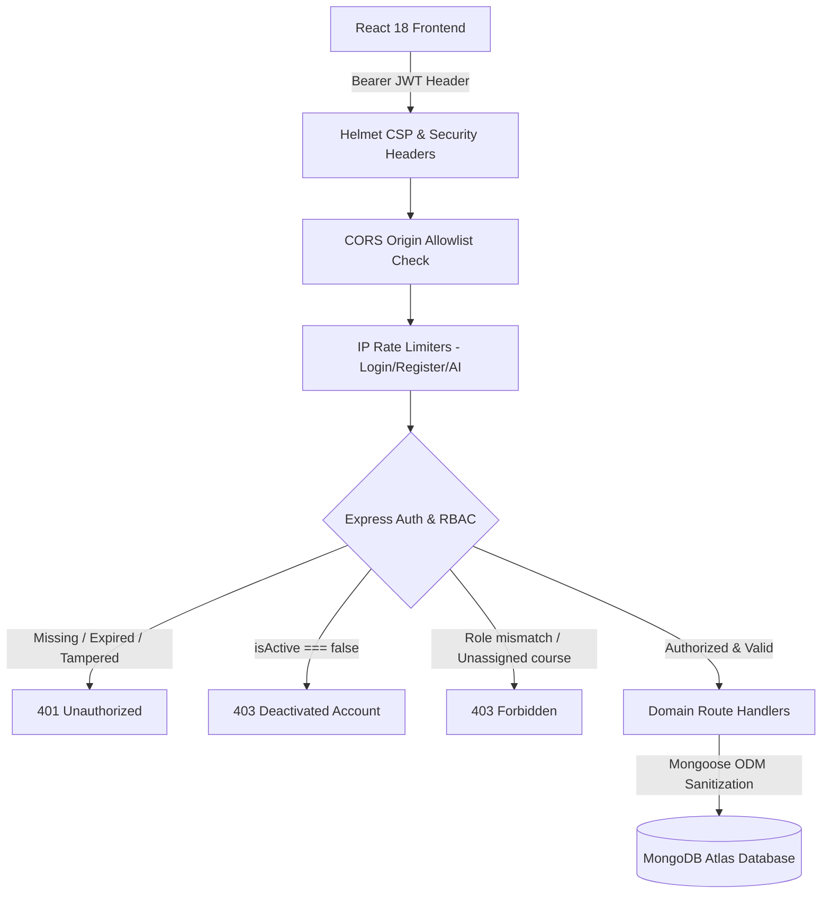

# CampusOne — Application Security Review & Hardening Audit

**Project:** CampusOne  
**Evaluation Scope:** MERN Stack Architecture (Node.js/Express API, MongoDB/Mongoose, React 18 Frontend, Web Worker Sandbox)  
**Status:** **Security Hardened & Staging Ready**  

---

## 1. Security Architecture & Threat Model

CampusOne enforces a zero-trust model at the Express.js API boundary. The frontend client is treated as an untrusted actor. Client-side persona switchers or role labels are for UI preview only; every data mutation and data retrieval is verified by backend middleware.

---

## 2. Threat & Vulnerability Audit Matrix

| ID | Vulnerability / Finding | Severity | Affected Component | Required Mitigation | Verification Method | Status |
| :--- | :--- | :--- | :--- | :--- | :--- | :--- |
| **SEC-01** | **Deactivated Account Token Retention** | High (P1) | `server/middleware/auth.js` | Enforce `user.isActive === false` rejection (403) in JWT verification middleware. | `e2eWorkflowTest.js` Test #1 | **Resolved** |
| **SEC-02** | **Public Examination Answer Exposure** | High (P1) | `server/routes/test.routes.js` | Strip `correct` option index and `explanation` from public/student test listings. | `assessmentTest.js` Test #1 | **Resolved** |
| **SEC-03** | **Client-Side Score Trust** | High (P1) | `server/routes/test.routes.js` | Reject client-calculated scores; compute grade and pass/fail strictly on server against DB keys. | `assessmentTest.js` Test #2 | **Resolved** |
| **SEC-04** | **Unassigned Course Attendance Tampering** | Medium (P2) | `server/routes/academic.routes.js` | Verify `subjectsHandled` array for faculty users during attendance submission. | `e2eWorkflowTest.js` Test #2 | **Resolved** |
| **SEC-05** | **Cross-Student Exam Attempt Snooping** | Medium (P2) | `server/routes/test.routes.js` | Restrict `GET /results/:attemptId` to the attempt owner, faculty, or institutional admin. | `e2eWorkflowTest.js` Test #5 | **Resolved** |
| **SEC-06** | **Unbounded AI Input Prompt Flood** | Low (P3) | `server/routes/ai.routes.js` | Bound incoming message strings to 2000 characters; reject oversized prompts with 400 Bad Request. | `e2eWorkflowTest.js` Test #6 | **Resolved** |
| **SEC-07** | **Web Worker Sandbox Network Exfiltration** | Medium (P2) | `client/src/services/codeRunner.js` | Nullify `self.fetch`, `self.XMLHttpRequest`, `self.WebSocket`, and `self.importScripts` in worker context. | Code inspection & Worker sandbox tests | **Resolved** |
| **SEC-08** | **Environment Secrets in Source Control** | Critical (P0) | `.env`, `server/.env` | Never commit `.env` files; enforce `.gitignore`; validate presence of `JWT_SECRET` and `MONGO_URI` at boot. | Startup check & git history review | **Resolved** |
| **SEC-09** | **CORS Configuration Wildcards** | High (P1) | `server/server.js` | Environment-driven origin allowlist (`CLIENT_URL`); reject unauthorized foreign origins with 403. | `securityAndStagingTest.js` Test #5 | **Resolved** |
| **SEC-10** | **Missing HTTP Security Headers** | High (P1) | `server/server.js` | Integrated `helmet` with custom CSP (`worker-src 'self' blob:`, `nosniff`, `frame-ancestors 'none'`). | `securityAndStagingTest.js` Test #4 | **Resolved** |
| **SEC-11** | **Brute-Force & Credential Stuffing** | High (P1) | `server/server.js` | Configured `loginLimiter`, `registerLimiter`, and `aiLimiter` returning HTTP 429 Too Many Requests. | `securityAndStagingTest.js` Test #7 | **Resolved** |
| **SEC-12** | **Public Role Escalation to Admin** | High (P1) | `server/server.js` | Public registration blocked from creating `admin` or `teacher` accounts without valid `adminSecret`. | `securityAndStagingTest.js` Test #8 | **Resolved** |

---

## 3. Sandboxed Code Execution Engine Security

The **CampusOne Code Hub** executes user-submitted JavaScript code for algorithms (e.g. Knapsack, Two Sum, BFS) within a browser-side sandboxed environment using HTML5 Web Workers.

### Security Guarantees:
1. **Thread Isolation:** User code executes off the main UI thread. It has zero access to the DOM, `window`, `document`, `localStorage`, or `sessionStorage`.
2. **Infinite Loop & Resource Protection:** A strict `setTimeout` monitor terminates the worker after `2000ms`, neutralizing runaway `while(true)` loops and excessive recursion.
3. **Network API Lockdown:** In-worker APIs `self.fetch`, `self.XMLHttpRequest`, `self.WebSocket`, and `self.importScripts` are overridden to `undefined` before executing user code, preventing network exfiltration of student session data.
4. **Host Server Safety:** **No student code is sent to or executed on the Node.js Express server.** All user execution is confined entirely to the client-side sandboxed worker.
5. **Content Security Policy Integration:** Helmet CSP directives explicitly permit `worker-src 'self' blob:` and `script-src 'self' 'unsafe-inline' blob:`, ensuring sandboxed Web Worker Blob URLs run without violation errors.

---

## 4. Authentication Strategy & Architectural Decision

### Decision: Retain Bearer Token Strategy with Hardened Defense-in-Depth
CampusOne evaluated whether to retain Bearer tokens in headers or migrate to HttpOnly cookies. The Bearer token strategy is retained based on the following architectural rationale:

1. **CSRF Immunity:** Bearer tokens passed via the `Authorization` header are inherently immune to Cross-Site Request Forgery (CSRF). Browsers never automatically attach `Authorization: Bearer` headers to cross-site requests, eliminating the need for complex CSRF token synchronization in decoupled SPAs.
2. **Decoupled Staging & Cloud Deployments:** Modern decoupled hosting (frontend on edge CDN/Vercel and API on a separate subdomain like `api.staging.campusone.edu`) often encounters cross-site cookie blocking (Safari ITP, Chrome Privacy Sandbox). Bearer tokens remain robust across distinct subdomains.
3. **Defense-in-Depth Mitigations Against Token Theft:**
   - **XSS Prevention:** Enforced via Helmet CSP, DOM sanitization, and network-disabled Web Workers.
   - **Immediate Invalidation on Deactivation:** Server-side `protect` middleware inspects `user.isActive` on every authenticated request; deactivated accounts are immediately locked out with HTTP 403 regardless of token expiry.
   - **Bounded Expiration:** Tokens are configured with a 7-day expiration (`JWT_EXPIRES_IN=7d`).
   - **Clean Session Termination:** Client logout clears `localStorage.removeItem('campusone_token')` and resets React state.

---

## 5. Observability, Logging & Secret Redaction

1. **Request Correlation IDs:** Every incoming HTTP request is assigned a unique UUID via the `X-Request-Id` response header (or propagates incoming client IDs for distributed tracing).
2. **Structured JSON Logs:** In staging and production, all requests log in structured JSON format including `requestId`, `method`, `path`, `statusCode`, `durationMs`, and ISO timestamps.
3. **Secret Redaction:** Logs and error handlers sanitize and redact `password`, `token`, `authorization`, `adminSecret`, and database connection credentials.
